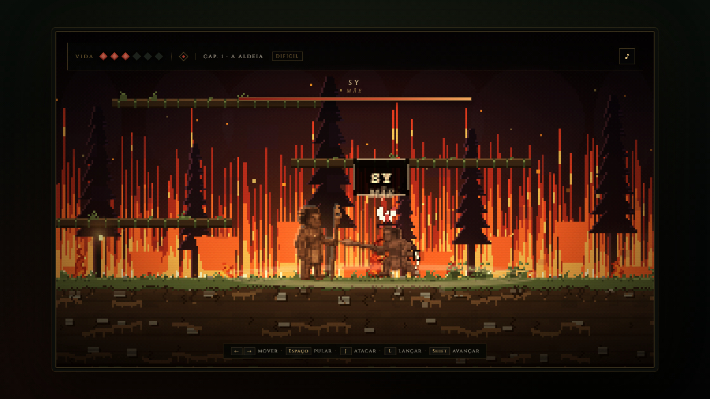

# Sandman — O Guardião da Floresta

[](https://github.com/eduardoosganascimento-beep/Game.Cesar/actions/workflows/deploy.yml)


Jogo indie 2D em pixel art que roda direto no navegador. **TypeScript + Canvas 2D + CSS**,
sem dependências de runtime e sem instalação para jogar.

> A aldeia caiu. A família de Sandman foi levada rio abaixo por colonos.
> Anos de preparo depois, o guardião volta para resgatar quem ama — e acertar as contas.

## Jogar agora

**[eduardoosganascimento-beep.github.io/Game.Cesar](https://eduardoosganascimento-beep.github.io/Game.Cesar/)**

O site é publicado pelo workflow `.github/workflows/deploy.yml` a cada `push` em `main`.
Em *Settings → Pages → Source*, mantenha **GitHub Actions** selecionado.



## O que tem no jogo

- **Cinco capítulos** com cutscenes, checkpoints e um chefe indígena da família de Sand
  (Sy, Tuba, Kypy'y e Kybykuera). O guardião final fecha a jornada no Capítulo 5.
- **Combate**: golpe com a lança, arremesso, dash, **parry com F** (o PERFECT devolve a
  lança do inimigo) e riposte com dano dobrado.
- **Chefes com personalidade**: golpes em combo, arremesso correndo como o índio,
  investida, guarda e contra-ataque. Eles leem a lança do jogador e desviam no impacto;
  abaixo de 40% de vida entram na **fase de brasa**, mais rápidos e vermelhos.
- **Vida e dano justos**: Sand começa com **6 corações**. Colonos, zumbis e armadilhas
  tiram 1; chefes tiram 2. Nenhum dano devolve o jogador ao início — água e quedas
  resgatam no último chão seguro.
- **Plataformas**: suba pulando de baixo e desça com **↓ + Espaço**.
- **Três dificuldades** (Fácil, Normal, Difícil) salvas no navegador, com velocidade,
  dano e vida escalados — incluindo o chefe.
- **Tutorial jogável**, pausa (Esc), barra de vida do chefe, efeitos de impacto,
  poeira, faíscas, rastro de dash e áudio sintetizado com Web Audio.

## Controles

| Ação | Tecla |
| --- | --- |
| Mover | `←` `→` ou `A` `D` |
| Pular | `Espaço`, `↑` ou `W` |
| Descer pela plataforma | `↓` + `Espaço` |
| Atacar (corpo a corpo) | `J` ou `Z` |
| Arremessar a lança | `L` ou `X` |
| Parry / bloqueio | `F` |
| Dash | `Shift` ou `K` |
| Pausar / voltar | `Esc` |
| Reiniciar capítulo | `R` |

## Capítulos

| # | Capítulo | Tema |
| --- | --- | --- |
| — | Tutorial — A Trilha | Bosque |
| 1 | A Aldeia | Aldeia em chamas |
| 2 | O Rio Escuro | Rio e névoa |
| 3 | As Ruínas | Templo à noite |
| 4 | O Reencontro | Bosque sagrado |
| 5 | O Regresso | Amanhecer e guardião |

As fases `cap6` a `cap9` também estão versionadas e validadas em `src/data/levels/`,
prontas para campanhas futuras.

## Estrutura

```
Game.Cesar/
├── index.html              # menu, HUD, pausa e tela de fim
├── styles/main.css         # layout, molduras e overlays
├── src/
│   ├── main.ts             # loop, regras de fase e renderização
│   ├── engine.ts           # constantes, câmera e colisão AABB
│   ├── input.ts            # teclado
│   ├── player.ts           # movimento, plataformas, ataque e arremesso
│   ├── enemy.ts            # IA dos inimigos e dos chefes
│   ├── level.ts            # tilemap e leitura dos JSONs
│   ├── chapters.ts         # capítulos e cutscenes
│   ├── difficulty.ts       # dificuldades e persistência
│   ├── animator.ts         # clipes de animação
│   ├── sprites.ts          # atlas, recortes e colorização
│   ├── background.ts       # fundos estáticos e animados
│   ├── scenery.ts          # chão, água, plataformas e espinhos
│   ├── effects.ts          # partículas, tremor e texto flutuante
│   ├── audio.ts            # Web Audio
│   ├── bosses.ts           # stats e paletas dos chefes
│   └── ui/                 # HUD, menus e enquadramento da arena
├── public/assets/          # sprites e fontes (embutidos no build)
├── scripts/                # geradores de sprites e validador de fases
├── docs/                   # plano, arte, capturas e fluxograma
└── .github/workflows/      # deploy automático
```

## Desenvolvimento

Requisitos: **Node.js 18+** e npm.

```bash
npm install
npm run dev              # http://localhost:5173
npm run typecheck        # tsc --noEmit
npm run levels:check     # valida cap1..cap9 + tutorial
npm run build            # build de produção em dist/
npm run preview          # serve dist/ em http://localhost:4173
```

O plugin `virtual:sandman-assets` embute os arquivos de `public/` no bundle como
data URI, então o site funciona em qualquer hospedagem, inclusive subpasta.

## Documentação

- [Plano do jogo](docs/PLANO-DO-JOGO.md)
- [Guia de arte](docs/ARTE.md)
- [Fluxograma (SVG)](docs/fluxograma-do-jogo.svg) · [cena editável do Excalidraw](docs/fluxograma-do-jogo.excalidraw)
- [Notas de versão](docs/CHANGELOG.md)
- [Banco de dados / API do jogo](database/README.md)

## Créditos

Conceito, história, código e arte: projeto **Game.Cesar**. Referências históricas e
visuais em `docs/PLANO-DO-JOGO.md`.
